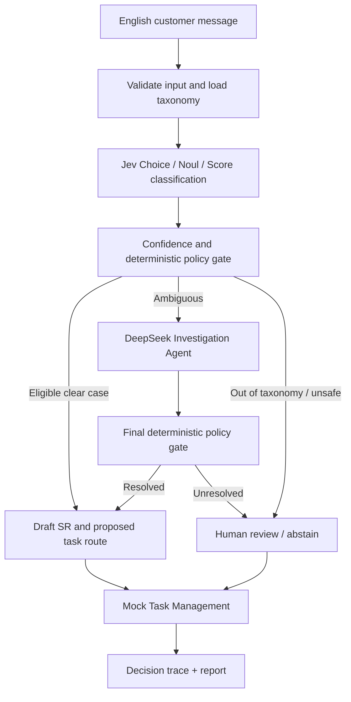

# Service Request Triage

**A graph-based, confidence-aware AI proof of concept for classifying English-language customer requests and proposing Service Request / Task routing.**

> Status: architecture + execution backlog. This repository does **not** yet contain a working classifier, graph runtime, or business integration. All datasets and case-management rules are **synthetic**.

## Why this project exists

A customer may submit a free-text request through an internet bank or another channel. Before creating Service Requests (SRs) and internal/external Tasks, the system should distinguish:
1. **Semantic understanding:** intent, domain, requested outcome, multiple intents, uncertainty;
2. **Formal classification:** the proposed SR type and reason code under a versioned taxonomy;
3. **Policy decision:** whether to auto-propose a draft, escalate to a generative LLM, require human review, or abstain;
4. **Workflow execution:** state transitions, mock Task Management, traceability and eventual human approval.

This is intentionally **not** a second multi-agent supervisor team. The first project explores autonomous multi-agent review; this one explores **Conditional State Graph + Jev decision model + selective LLM escalation + Human-in-the-Loop**.

## Proposed stack (verify at bootstrap)

| Component | Baseline |
|---|---|
| Language | Java 25 LTS, English-only code/prompts/fixtures |
| Backend | Spring Boot 3.5.x |
| Graph runtime | Spring AI Alibaba Graph 1.1.2.0 (StateGraph, conditional edges) |
| Spring AI | 1.1.2, aligned BOM |
| Fast judgment model | TypeSafe **Jev**, `jev-latest` via HTTP `POST /v1/systemone` |
| Investigative LLM | DeepSeek using Spring AI adapter, behind an application port |
| Classification logic | Versioned synthetic taxonomy + deterministic Java policy |
| Durable HITL (later) | Graph checkpointing; PostgreSQL after in-memory prototype |
| Business integration | In-memory/mock Task Management, **no real banking APIs** |
| Evaluation | Synthetic goldset, Jev-only vs DeepSeek-only vs hybrid |

Exact released patch and graph persistence dependency/API will be validated and pinned in FEATURE-001 / FEATURE-011. Cloud API keys are separate from ChatGPT/Dify credits.

## Intended process

**Important:** a `Draft SR` is an **intent/proposal**. The model does not independently execute transfers, issue refunds, or register legally significant complaints. No irreversible action without explicit authorization.

## Documentation map

- [Architecture](docs/architecture.md) — C4-style context, graph state, branch semantics, responsibility boundaries.
- [ADRs and trade-offs](docs/adr/README.md) — key decisions and alternatives.
- [Domain contracts and sample requests](docs/contracts.md) — Java records, TypeSafe JSON, policy and API contracts.
- [Implementation plan](docs/implementation-plan.md) — phased work with FEATURE issue dependencies.
- [Evaluation](docs/evaluation.md) — English goldset, abstention and calibration, error-cost metrics.
- [Assumptions and risks](docs/assumptions-and-risks.md) — security, data, reproducibility and non-goals.
- [Collaboration workflow](docs/collaboration.md) — parallel Claude Code / Codex worktrees, PR boundaries and merge protocol.
- [CLAUDE.md](CLAUDE.md) / [AGENTS.md](AGENTS.md) — instructions for coding assistants.

## Start here

1. Read **Architecture**, **ADRs**, and **Contracts** before code generation.
2. Implement **FEATURE-001 : Project Bootstrap**, then **FEATURE-002 : Jev API Integration**.
3. Build a Jev-only benchmark and dataset before adding Graph or DeepSeek; preserve an objective baseline.
4. Add Graph branching, an optional DeepSeek agent, then checkpoint/resume and mock human review.
5. Measure gains and regressions: latency, cost, classification Macro-F1, complaint recall, error rate among automated routes, escalation rate, and recovery.

## Security and privacy

Only use invented English customer requests and synthetic account context. Never submit real client/bank data, customer identifiers, internal taxonomy, credentials or source code to Jev or DeepSeek without explicit corporate approval. Provider answers are **untrusted judgments**; authorization, business invariants, and routing decisions are enforced by application code.

## Official references

- [TypeSafe Jev API](https://docs.typesafe.ai/api/system-one)
- [TypeSafe Companion Noul](https://docs.typesafe.ai/patterns/companion-noul)
- [TypeSafe Hierarchical Classification](https://docs.typesafe.ai/cookbooks/hierarchical_classification)
- [Spring AI Alibaba versions](https://java2ai.com/docs/versions/)
- [Spring AI Alibaba Graph](https://java2ai.com/docs/frameworks/graph-core/quick-start/)
- [Spring AI DeepSeek](https://docs.spring.io/spring-ai/reference/api/chat/deepseek-chat.html)
