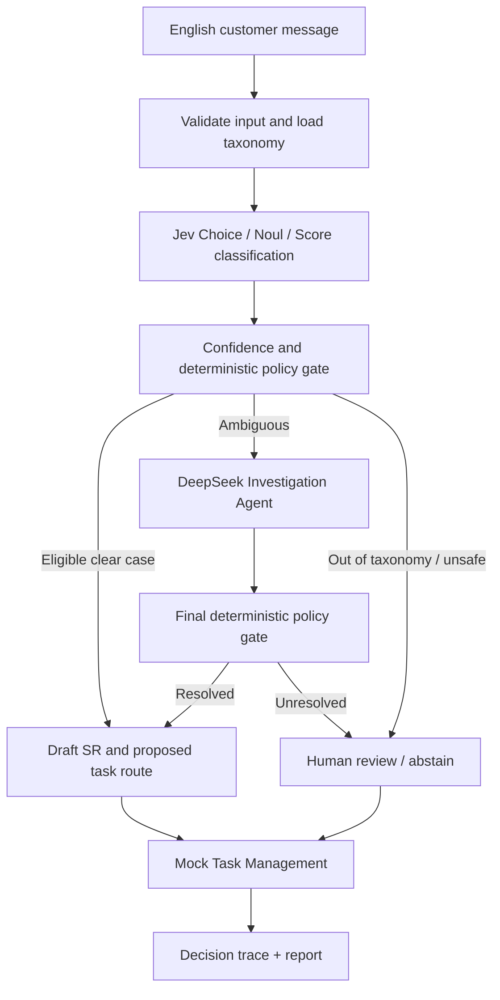

# Service Request Triage

**A graph-based, confidence-aware AI proof of concept for classifying English-language customer requests and proposing Service Request / Task routing.**

> Status: bootstrap skeleton (FEATURE-001). The Maven project builds, starts and exposes health endpoints; there is **no** classifier, triage graph, or business integration yet. All datasets and case-management rules are **synthetic**.

## Why this project exists

A customer may submit a free-text request through an internet bank or another channel. Before creating Service Requests (SRs) and internal/external Tasks, the system should distinguish:
1. **Semantic understanding:** intent, domain, requested outcome, multiple intents, uncertainty;
2. **Formal classification:** the proposed SR type and reason code under a versioned taxonomy;
3. **Policy decision:** whether to auto-propose a draft, escalate to a generative LLM, require human review, or abstain;
4. **Workflow execution:** state transitions, mock Task Management, traceability and eventual human approval.

This is intentionally **not** a second multi-agent supervisor team. The first project explores autonomous multi-agent review; this one explores **Conditional State Graph + Jev decision model + selective LLM escalation + Human-in-the-Loop**.

## Proposed stack (verify at bootstrap)

| Component | Baseline |
|---|---|
| Language | Java 25 LTS, English-only code/prompts/fixtures |
| Backend | Spring Boot 3.5.x |
| Graph runtime | Spring AI Alibaba Graph 1.1.2.0 (StateGraph, conditional edges) |
| Spring AI | 1.1.2, aligned BOM |
| Fast judgment model | TypeSafe **Jev**, `jev-latest` via HTTP `POST /v1/systemone` |
| Investigative LLM | DeepSeek using Spring AI adapter, behind an application port |
| Classification logic | Versioned synthetic taxonomy + deterministic Java policy |
| Durable HITL (later) | Graph checkpointing; PostgreSQL after in-memory prototype |
| Business integration | In-memory/mock Task Management, **no real banking APIs** |
| Evaluation | Synthetic goldset, Jev-only vs DeepSeek-only vs hybrid |

Exact released patch and graph persistence dependency/API will be validated and pinned in FEATURE-001 / FEATURE-011. Cloud API keys are separate from ChatGPT/Dify credits.

## Intended process



**Important:** a `Draft SR` is an **intent/proposal**. The model does not independently execute transfers, issue refunds, or register legally significant complaints. No irreversible action without explicit authorization.

## Build and run (FEATURE-001 skeleton)

Prerequisites: JDK 25 (for example `brew install openjdk@25`, then `export JAVA_HOME=/opt/homebrew/opt/openjdk@25/libexec/openjdk.jdk/Contents/Home`). Maven is provided by the wrapper; no cloud API keys are needed.

```bash
./mvnw -B verify                 # compile, enforcer rules, unit + context tests
./mvnw spring-boot:run           # start on http://localhost:8080
curl localhost:8080/actuator/health
curl localhost:8080/actuator/health/liveness
curl localhost:8080/actuator/health/readiness
./mvnw dependency:tree           # dependency matrix (a saved copy: docs/research/FEATURE-001-dependency-tree.txt)
```

Configuration is environment-only for secrets: copy `.env.example` to an untracked `.env` or export `JEV_API_KEY` / `DEEPSEEK_API_KEY`. Provider adapters are disabled by default (`triage.jev.enabled=false`, `triage.deepseek.enabled=false`) and live calls are opt-in in later tickets. Logs use Spring Boot structured logging (logstash JSON), which emits SLF4J MDC entries as top-level JSON fields (verified with a probe: `"triageId":"..."` appears next to `message`). `triageId` and `graphRunId` are the reserved correlation MDC keys; nothing populates them yet, later tickets will. Only `health` and `info` actuator endpoints are exposed.

Package layout under `io.github.denrzv.triage`: `api`, `domain.model`, `domain.port`, `application`, `graph`, `infrastructure.*`; boundaries are enforced by `ArchitectureBoundaryTest`.

### Jev adapter (FEATURE-002)

`JevClassificationPort` (`domain.port`) sends several named Choice / Noul / Score questions in one `POST {base-url}/v1/systemone` call and returns typed answers plus the resolved model, token usage, question-set version, latency and attempt count. The adapter (`infrastructure.typesafe`) makes no routing, taxonomy or task decisions; the taxonomy-aware `ClassificationModelPort` from `docs/contracts.md` is layered on top in later tickets.

| Property (`triage.jev.*`) | Default | Notes |
|---|---|---|
| `enabled` | `false` | The bean exists only when `true`; enabled with a blank key fails startup |
| `api-key` | `${JEV_API_KEY:}` | Environment only; never logged and never part of an exception message |
| `base-url` / `model` | `https://api.typesafe.ai` / `jev-latest` | The alias may resolve to a different model over time; the resolved model is recorded per call |
| `connect-timeout` / `request-timeout` | `5s` / `30s` | |
| `max-attempts` / `initial-backoff` / `max-backoff` | `3` / `200ms` / `2s` | Exponential backoff, capped; a numeric `Retry-After` is honoured up to the cap |

| Outcome | Exception | Retried |
|---|---|---|
| HTTP 2xx with valid answers | result | n/a |
| HTTP 2xx with a missing or malformed answer (never defaulted to 0 confidence) | `JevProtocolException` | no |
| HTTP 400, 401, 403, 422 and other non-retryable statuses | `JevClientException` | no |
| HTTP 429, 5xx, I/O error, timeout | `JevUnavailableException` after `max-attempts` | yes, bounded |

The TypeSafe documentation only specifies 200, 400 and 422 responses. Handling of 401, 403, 429 and 5xx (and any `Retry-After`) is by status class and has not been confirmed against the live API. A retried call can be billed again. Offline fixtures under `src/test/resources/jev` are derived from the documented schema, not captured from live traffic.

**Opt-in live smoke test.** It sends one synthetic English message to the real TypeSafe API and checks the response shape only. It is billed per input token by the provider and the message text is shared with that cloud provider, so use synthetic text only.

```bash
export JEV_API_KEY=...   # never commit it
JEV_LIVE_SMOKE=true ./mvnw -B -Dtest=JevLiveSmokeTest test
```

By default (`./mvnw -B verify`) the test is skipped and no key is needed.

### Compatibility findings (verified 2026-11-21)

| Item | Result |
|---|---|
| Spring Boot | 3.5.16 (latest 3.5.x on Maven Central); Java 25 build and tests pass |
| Spring AI | 1.1.2 via `spring-ai-bom` |
| Spring AI Alibaba | `spring-ai-alibaba-bom` 1.1.2.0 |
| Graph core artifact | `com.alibaba.cloud.ai:spring-ai-alibaba-graph-core:1.1.2.0` |
| DeepSeek adapter | `org.springframework.ai:spring-ai-deepseek:1.1.2`, transitive via graph-core; no starter added, provider inactive and the app starts without keys |
| Graph API verified | `StateGraph(KeyStrategyFactory)`, `addNode(String, AsyncNodeAction)`, `addEdge`, `compile()`, `CompiledGraph.invoke(Map)` returning `Optional<OverAllState>` (see `GraphDependencySmokeTest`) |
| Dependency drift | graph-core declares Jackson 2.19.4 and reactor-core 3.7.13, but Boot 3.5.16 resolves Jackson 2.21.4 and reactor-core 3.7.19; tests pass with the Boot-managed versions |
| Test tooling | Mockito 5.17.0 / ByteBuddy 1.17.8 / ArchUnit 1.5.1 work on Java 25 |
| Not executed | The GitHub Actions workflow has not run yet (needs a pushed branch/PR); live Jev/DeepSeek calls are not part of this ticket |
| Follow-up | SAA 1.1.2.1 to 1.1.2.4-security-fix exist and keep Spring AI 1.1.2; evaluate moving off 1.1.2.0 in a separate ticket |

### Continuous integration

GitHub Actions (all actions pinned by commit SHA, least-privilege tokens, superseded runs cancelled, no cloud credentials):

| Job | Workflow | Checks |
|---|---|---|
| `build` | `ci.yml` | `./mvnw -B verify` on Java 25 (Enforcer rules, unit and context tests) |
| `gitleaks` | `ci.yml` | Secret scan over full git history |
| `aidd-validation` | `ci.yml` | `scripts/check-aidd-pack.py` and `scripts/validate-workflow.py` for the ticket in `docs/.active_ticket` (keep it pointing at a ticket with complete artifacts) |
| `dependency-review` | `ci.yml` | Pull requests only: fails on newly introduced high-severity vulnerable dependencies |
| `analyze` | `codeql.yml` | CodeQL for Java on push, pull request and weekly |

Dependabot (`.github/dependabot.yml`) opens weekly Maven and GitHub Actions update pull requests and ignores Spring Boot and Spring AI major versions (ADR-005). These workflows are verified by their run on the pull request, not locally. Not included yet: coverage gate, SonarCloud, branch protection and an opt-in live provider smoke job.

## Documentation map

- [Architecture](docs/architecture.md) — C4-style context, graph state, branch semantics, responsibility boundaries.
- [ADRs and trade-offs](docs/adr/README.md) — key decisions and alternatives.
- [Domain contracts and sample requests](docs/contracts.md) — Java records, TypeSafe JSON, policy and API contracts.
- [Implementation plan](docs/implementation-plan.md) — phased work with FEATURE issue dependencies.
- [Evaluation](docs/evaluation.md) — English goldset, abstention and calibration, error-cost metrics.
- [Assumptions and risks](docs/assumptions-and-risks.md) — security, data, reproducibility and non-goals.
- [Collaboration workflow](docs/collaboration.md) — parallel Claude Code / Codex worktrees, PR boundaries and merge protocol.
- [CLAUDE.md](CLAUDE.md) / [AGENTS.md](AGENTS.md) — instructions for coding assistants.

## Start here

1. Read **Architecture**, **ADRs**, and **Contracts** before code generation.
2. Implement **FEATURE-001 : Project Bootstrap**, then **FEATURE-002 : Jev API Integration**.
3. Build a Jev-only benchmark and dataset before adding Graph or DeepSeek; preserve an objective baseline.
4. Add Graph branching, an optional DeepSeek agent, then checkpoint/resume and mock human review.
5. Measure gains and regressions: latency, cost, classification Macro-F1, complaint recall, error rate among automated routes, escalation rate, and recovery.

## Security and privacy

Only use invented English customer requests and synthetic account context. Never submit real client/bank data, customer identifiers, internal taxonomy, credentials or source code to Jev or DeepSeek without explicit corporate approval. Provider answers are **untrusted judgments**; authorization, business invariants, and routing decisions are enforced by application code.

## Official references

- [TypeSafe Jev API](https://docs.typesafe.ai/api/system-one)
- [TypeSafe Companion Noul](https://docs.typesafe.ai/patterns/companion-noul)
- [TypeSafe Hierarchical Classification](https://docs.typesafe.ai/cookbooks/hierarchical_classification)
- [Spring AI Alibaba versions](https://java2ai.com/docs/versions/)
- [Spring AI Alibaba Graph](https://java2ai.com/docs/frameworks/graph-core/quick-start/)
- [Spring AI DeepSeek](https://docs.spring.io/spring-ai/reference/api/chat/deepseek-chat.html)
