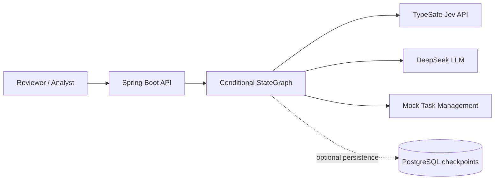
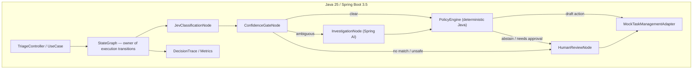

# Architecture — Service Request Intelligent Triage

**Status:** Proposed PoC design; implementation APIs and behavior to be verified against pinned releases.

## 1. System context (C4 Level 1)

User: a reviewer or analyst provides a **synthetic English** free-text customer request.

System: **Service Request Triage** classifies the text, evaluates confidence/policies, conditionally investigates ambiguity using an LLM, then returns a draft Service Request and proposed Task actions (or abstains and requests human review).

External dependencies:
- **TypeSafe API / Jev:** structured judgments (Choice, Noul, Score) about text.
- **DeepSeek API:** a generative agent used **only when needed**.
- **Mock Task Management:** synthetic target that stores draft intent and manual-review tasks.
- **Optional PostgreSQL**: checkpoint persistence in a later milestone.



## 2. Component boundaries (C4 Level 2/3)



A graph **node** performs an operation; **conditional edges** select next node based on explicit state. The graph is not an autonomous Supervisor with unrestricted agent delegation.

The graph's `TriageState` is distinct from the **Service Request domain state**. This PoC does not own the lifecycle of real enterprise SRs, Claims, Cases or Tasks.

## 3. Semantic classification vs formal SR categorization

Maintain three artifacts:

1. `SemanticAssessment`: primary intent, problem domain, requested outcome, refund intent, technical symptom, multi-intent flag, calibrated/observed provider scores and uncertainty.
2. `ClassificationProposal`: explicit taxonomy version, candidate SR type, reason code, alternative candidates and classification policy version.
3. `RoutingDecision`: `DRAFT_PROPOSAL`, `LLM_INVESTIGATION`, `HUMAN_REVIEW`, `ABSTAIN`; plus reasons and a list of proposed task actions.

Example: a customer may complain **about a technical malfunction**. An intent `COMPLAINT` and domain `DIGITAL_CHANNELS` does not imply that formal SR type must be `TECHNICAL_REQUEST`. Only **versioned rules** produce formal type and route.

## 4. Taxonomy (v1; illustrative, not bank policy)

```text
ServiceRequestType
├── CLAIM          # formal complaint / dispute
├── TECHNICAL_REQUEST
├── INFORMATION_REQUEST
├── SERVICE_REQUEST
└── UNCLASSIFIED   # abstention / needs triage

ProblemDomain
├── PAYMENTS
├── ACCOUNTS
├── DIGITAL_CHANNELS
├── SUPPORT_SERVICE
└── OTHER

RequestedOutcome
├── REFUND
├── FIX_PROBLEM
├── INVESTIGATE
├── EXPLAIN
├── PERFORM_ACTION
└── NOT_SPECIFIED
```

Version taxonomy as `taxonomyVersion`. Do not collapse meaningful multi-intent text into one forced label without a human-review path. Allow out-of-taxonomy cases and companion Noul: *"Does any offered category fit?"* A high Choice score is not sufficient if the taxonomy itself does not fit.

## 5. Graph nodes / edges

| Node | Side effect? | Output / branch |
|---|---|---|
| ValidateInput | no | Accept/reject, sanitized bounded input |
| LoadTaxonomy | read-only | Versioned taxonomy and policy |
| JevClassify | remote API | Typed decisions and raw metadata |
| ConfidenceGate | deterministic | Clear / ambiguous / no-match / unsafe |
| LlmInvestigate | remote API + read-only tools | Evidence-grounded recommendation |
| FinalPolicyGate | deterministic | Proposed type & task route / human review / abstain |
| CreateMockDraft | idempotent mock side effect | Draft SR + task proposal reference |
| WaitForHuman | pause/interruption (milestone 4) | Approve/correct/reject |
| BuildTrace | deterministic | Decision report and metrics |

Plan one bounded fallback to the LLM and optionally one re-evaluation after the LLM. Prevent graph loops from consuming unbounded model tokens. No model output may change the permitted graph structure or tool privileges.

**Required edge rules:**
- Missing/invalid Jev response → safe `HUMAN_REVIEW` or `ERROR`, never implicit confident routing.
- Out-of-taxonomy companion Noul low score → `ABSTAIN` / review.
- Threshold mismatch or ambiguous near-tie → optional LLM.
- Low confidence after fallback → human review.
- Risk-sensitive categories (e.g. explicit financial dispute) can require review even with high confidence.
- Backend verifies legal/financial routing policies independent of prompts.

## 6. Jev-first decision design

Use **one request with multiple typed questions**, unless hierarchical routing or ablations justify stages. Jev `Choice` returns `choice`, `probabilities`, `confidence`; `Noul` returns probability of true; `Score` returns a rubric-weighted score + probabilities + confidence. The model **does not** produce a natural-language reason or create tasks itself.

Example judgments: `primary_intent`, `problem_domain`, `requested_outcome`, `refund_requested`, `multi_intent`, `taxonomy_fit` (Companion Noul), `customer_urgency`. Model returns structured data to `JevClassificationPort`. Rules use typed values; do not ask Jev to execute policy.

**Confidence caveat:** `choice.probabilities[selected]` and `choice.confidence` are different fields; confidence is not ground-truth correctness. Thresholds are hypotheses to be calibrated using held-out gold labels and business costs.

Hierarchical classification (Choice at domain level followed by reason-code level) is an **optional comparative experiment**, not required for the first slice.

## 7. LLM Investigation Agent (conditional)

DeepSeek (via Spring AI) gets a bounded `InvestigationRequest` containing the original English message, Jev assessments, taxonomy alternatives and previously retrieved policy context. Tools:
- `getTaxonomyDefinition(typeOrCode)`
- `getClassificationPolicy(policyId)`
- `findSimilarSyntheticCases(query, maxResults)`
- `getSyntheticCustomerContext(customerRef)`

All tools are read-only, scoped, sanitized, and never access the evaluation goldset. LLM returns a **typed suggestion + cited policy/case IDs + unresolved questions**, not executable commands. Deterministic PolicyGate re-evaluates outputs.

## 8. Durability and recovery

M1/M2: in-memory graph for simplest experiments; no durable guarantee. M4: checkpoint state with PostgreSQL, then test restart mid-human-review. The framework's checkpoint/resume semantics (incl. interrupt/resume API) must be validated in a Java integration test before describing them as guaranteed. External mock side effects are at-least-once under recovery and must have deterministic idempotency keys.

We intentionally **do not combine Temporal with the graph** in v1. A graph checkpointer persists graph state at supported boundaries; it is **not an automatic exactly-once transactional workflow engine**. Human approval and SR lifecycle remain explicit application concerns.

## 9. Source data, privacy and authorization

- Every message is **English-only synthetic**; no translation or multilingual evaluation required.
- No actual banking system IDs, classifications, customer data, account numbers, complaints, or product rules.
- Provider keys loaded from environment/secrets; HTTPS; timeouts, retry limits, request size caps.
- Source text is untrusted for prompt injection; no arbitrary network, shell or write-capable LLM tools.
- Mock task actions cannot create real SRs; final approval controls any hypothetical side effect.

## 10. Observability

Record `triageId`, `graphRunId`, taxonomy/policy/prompt versions, chosen branch, provider model/version, confidence + probability top-2, threshold version, escalation reason, token counts, estimated cost, latency, human correction and final status. Do not log raw messages by default in a non-synthetic future environment.

## 11. Proposed project packaging

```text
src/main/java/.../triage/
  api/
  domain/model/                 # records, enums, invariants
  domain/port/                  # Jev, LLM, taxonomy, task management
  application/                  # use cases and policy
  graph/                        # nodes, edges, state
  infrastructure/
    typesafe/                   # HTTP adapter
    deepseek/                   # Spring AI adapter
    taxonomy/                   # synthetic versioned definitions
    taskmanagement/             # mock adapter
    persistence/                # later checkpointer
    observability/
src/main/resources/
  prompts/investigation.md
  taxonomy/v1.json
  policy/v1.json
src/test/
samples/english-goldset/
docs/
```

## Official references

- https://docs.typesafe.ai/api/system-one
- https://docs.typesafe.ai/patterns/companion-noul
- https://docs.typesafe.ai/cookbooks/hierarchical_classification
- https://java2ai.com/docs/versions/
- https://java2ai.com/docs/frameworks/graph-core/quick-start/
