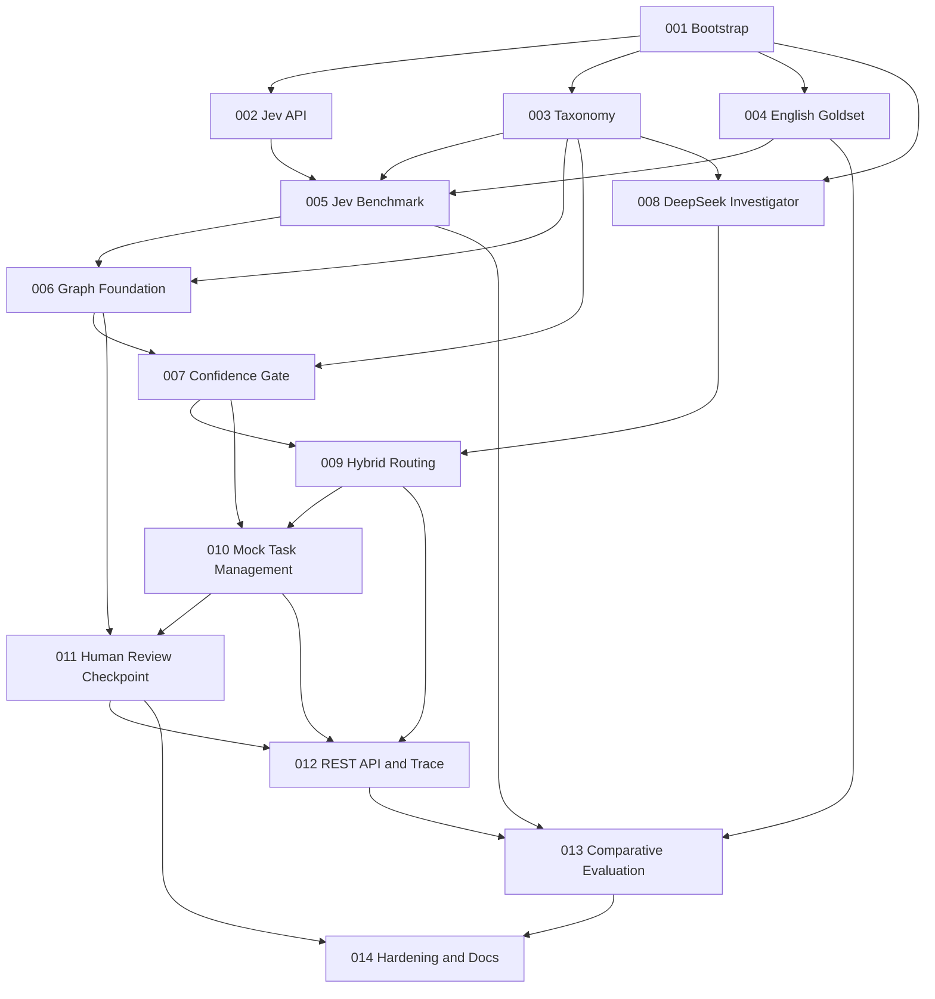

# Implementation Roadmap — FEATURE Issues

Use **one vertical slice per issue**. Title convention: `FEATURE-00X : Short Title`. Each ticket links dependencies, includes acceptance criteria and must result in tested, reviewable code or a verifiable artifact.

## Dependency graph

## Issue index

| ID | Short title | Deliverable | Dependencies |
|---|---|---|---|
| FEATURE-001 | Project Bootstrap | Java 25 + Boot 3.5 + Graph compatible Maven skeleton, CI | — |
| FEATURE-002 | Jev API Integration | Typed TypeSafe HTTP adapter + live opt-in smoke | 001 |
| FEATURE-003 | Taxonomy and Policy | Versioned English taxonomy, pure Java policy rules | 001 |
| FEATURE-004 | English Goldset | 200–300 synthetic cases, labels and held-out split | 001 |
| FEATURE-005 | Jev Baseline Benchmark | Jev-only and rules-only evaluation without Graph | 002, 003, 004 |
| FEATURE-006 | StateGraph Foundation | Conditional graph and explicit `TriageGraphState` | 003, 005 |
| FEATURE-007 | Confidence Routing | Companion Noul, policy gate, abstention and tests | 003, 006 |
| FEATURE-008 | DeepSeek Investigator | LLM adapter, structured suggestions and read-only Tools | 001, 003 |
| FEATURE-009 | Hybrid Triage Graph | Bounded conditional LLM fallback, one re-evaluation max | 007, 008 |
| FEATURE-010 | Mock Task Management | Idempotent synthetic draft SR/task proposals | 007, 009 |
| FEATURE-011 | Human Review Checkpoint | Pause/resume, approved correction, PostgreSQL checkpoint | 006, 010 |
| FEATURE-012 | REST API and Decision Trace | Endpoints, results/status, Micrometer/trace | 009, 010, 011 |
| FEATURE-013 | Comparative Evaluation | Jev-only vs LLM-only vs hybrid report with error-cost metrics | 004, 005, 012 |
| FEATURE-014 | Hardening and Guide | Negative tests, security, final docs, reproducible demo | 011, 013 |

## Milestones

**M0 — Planning & setup:** docs and GitHub Issues; pass FEATURE-001 Maven dependency matrix and project CI.

**M1 — Model experiment:** FEATURE-002 through FEATURE-005. Crucial: measure Jev **before** introducing graph or LLM complexity. The English goldset must be independent of providers.

**M2 — Deterministic decision graph:** FEATURE-006 and FEATURE-007. Observe branches, confidence, stop/abstain policies and negative paths.

**M3 — Adaptive graph:** FEATURE-008 to FEATURE-010. Enable a single bounded DeepSeek investigator, and use mock Task Management with idempotent drafts.

**M4 — Durable review:** FEATURE-011 and FEATURE-012. PostgreSQL checkpointing and a Human-in-the-Loop pause/resume demonstration, plus REST and tracing.

**M5 — Evidence and hardening:** FEATURE-013 and FEATURE-014. Compare baselines fairly, then document trade-offs and whether hybrid gives any improvement.

## Shared acceptance criteria

- Version all question sets, taxonomy definitions, model aliases/prompts and policy thresholds.
- Java policies and graph conditional edges are the **only** owners of final routing decisions.
- Jev choices never silently force a formally valid SR type when taxonomy fit is low.
- The LLM has no write/execute tools and cannot bypass manual approval.
- All test data, domain examples and comments are English and synthetic.
- Non-happy paths (invalid API, timeout, low confidence, repeated triageId, resume) are tested.
- No credentials, internal bank data or labeled goldset leak into prompts/LLM retrieval.
- Run exact Maven build/tests with pinned releases and report failures; do not claim compile-ready code if not tested.

## Parallel development

Read [Collaboration](collaboration.md) and follow separate worktrees/PRs. FEATURE-002, FEATURE-003 and FEATURE-004 can be parallelized **after** FEATURE-001; later merge gates depend on shared interfaces. Do not let two assistants edit `main` concurrently or duplicate the same feature.

## Experimental comparison

Measure rules-only, Jev-only, DeepSeek-only and hybrid using the same frozen taxonomy/goldset with comparable route policies. Graph complexity must justify its cost and error rate; do not present it as inherently superior.

## Definition of done

Each issue is closed only when its acceptance tests pass, docs updated and a linked PR merged. Where live cloud keys are required, provide offline test doubles plus opt-in live smoke instructions.

## References

- [Architecture](architecture.md)
- [ADRs](adr/README.md)
- [Contracts](contracts.md)
- [Evaluation](evaluation.md)
- [Assumptions](assumptions-and-risks.md)
